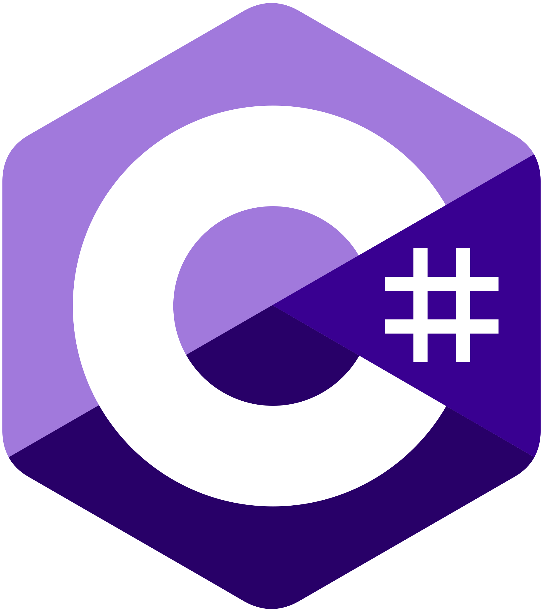
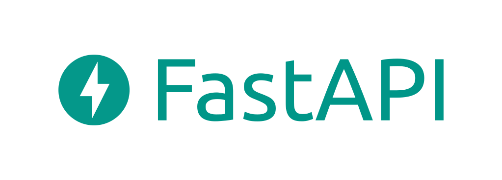

# Hi , I'm Jay Trivedi

    

    

## 💁‍ About me

- I have **3 Years** of experience.
- I develop **Websites**, **BOTs**, **Automation**, **Web Scrapers**, **Desktop App** and much more...
- I also **deploy** app on **Docker**, **Kubernetes** using cloud providers such as **AWS**, **GCP**, **Azure**, Linode,
  DigitalOcean and more...
- I also **design** DataBases and Systems.
- I completed **15+ Projects**.
- I provide **Full Stack service**.

## 🤝 Connect with Me

Feel free to contact me at any time for anything.

    
    

## 👉 My Skills

### 👉 Programming Languages

    
    
    
    

### 👉 Frontend Development

    
    
    
    
    

### 👉 Backend Development

    
    
    
    

### 👉 Database

    
    
    
    
    
    

### 👉 DevOps

    
    
    
    
    
    
    
    

### 👉 Automation

    
     
    

### 👉 Software & Tools

    
    
    

---

## 📊 GitHub Stats

---

## 🧑‍💻 Hire Me

    
    

## 📞 Contact Me

Feel free to contact me for anything.

**Note: Provided information is used only to connect with you.**

<a target="_blank" href="https://forms.gle/LJKV2XKpHHVKtZvKA">
<button
  class="talk-btn inline-flex gap-2.5 border text-center tracking-wider text-white cursor-pointer bg-transparent">
  <svg style="vertical-align: middle;" class="inline-flex items-center justify-center w-6 h-6" aria-hidden="true" focusable="false" role="img"
       xmlns="http://www.w3.org/2000/svg" viewBox="0 0 384 512" data-fa-i2svg="">
    <path fill="currentColor"
          d="M80 48c8.8 0 16 7.2 16 16V208v32H80c-5.5 0-10.8 .6-16 1.6V64c0-8.8 7.2-16 16-16zM16 64V272C6 285.4 0 302 0 320c0 0 0 0 0 0v24c0 92.8 75.2 168 168 168h48c92.8 0 168-75.2 168-168V288 256 128c0-35.3-28.7-64-64-64s-64 28.7-64 64v50c-5.1-1.3-10.5-2-16-2c-7.9 0-15.4 1.4-22.4 4c-10.4-21.3-32.3-36-57.6-36c-5.5 0-10.9 .7-16 2V64c0-35.3-28.7-64-64-64S16 28.7 16 64zM336 256v32 56c0 66.3-53.7 120-120 120H168c-66.3 0-120-53.7-120-120V320s0 0 0 0c0-17.7 14.3-32 32-32h40 40c8.8 0 16 7.2 16 16s-7.2 16-16 16H120c-13.3 0-24 10.7-24 24s10.7 24 24 24h40c15.1 0 29-5.3 40-14c11 8.8 24.9 14 40 14c35.3 0 64-28.7 64-64V256 240 128c0-8.8 7.2-16 16-16s16 7.2 16 16V256zM160 240H144V208c0-8.8 7.2-16 16-16s16 7.2 16 16v32 2c-5.1-1.3-10.5-2-16-2zm96 16v48c0 8.8-7.2 16-16 16s-16-7.2-16-16V264 240c0-8.8 7.2-16 16-16s16 7.2 16 16v16z"></path>
  </svg>
  
Let's talk

</button>
</a>

#### Attribution to Free tools

I am thankful to free platforms. I will be grateful to contribute on platforms with my skills.

- Card Image by <a href="https://www.canva.com/" target="_blank">Canva</a>
- Animated Icons by <a target="_blank" href="https://icons8.com">Icons8</a>
- Icons by <a href="https://www.flaticon.com" target="_blank">Flaticon</a>
- Animated Emoji by <a target="_blank" href="https://joypixels.com/">joypixles</a>
